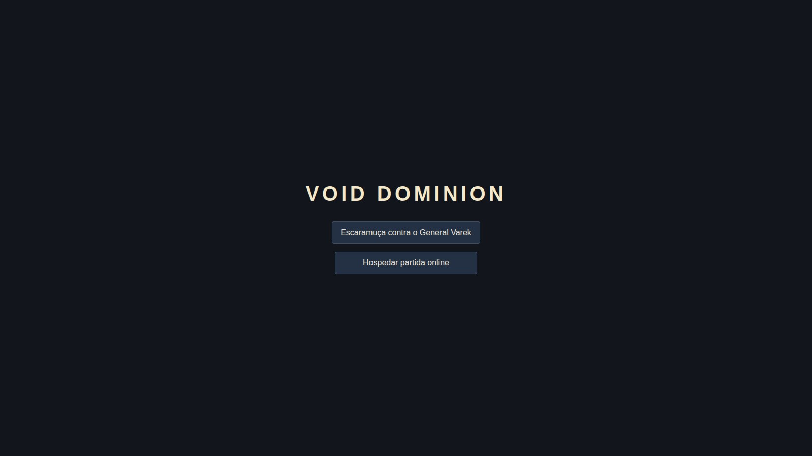
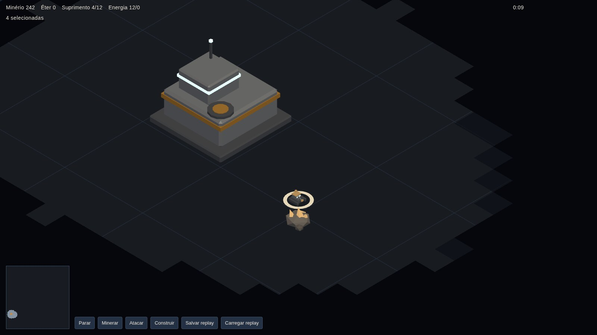
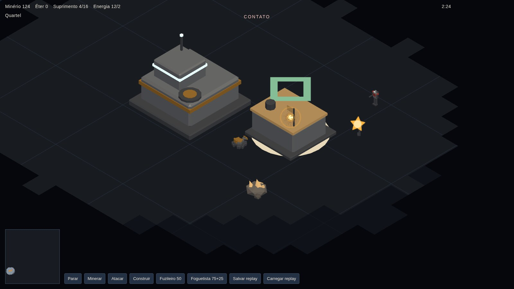

<p align="center">
  
</p>

<h1 align="center">Void Dominion</h1>

<p align="center"><strong>Every order is checked. Every match replays exactly.</strong></p>

<p align="center">
  <a href="https://gamestudio42.github.io/void-dominion/"></a>
  <a href="https://github.com/gamestudio42/void-dominion/actions/workflows/pages.yml"></a>
  <a href="https://github.com/gamestudio42/void-dominion/stargazers"></a>
  <a href="https://github.com/gamestudio42"></a>
</p>

<p align="center">
  A real-time strategy game in the browser. You command the Helion Directorate on the Erebus Frontier,
  against General Varek on the other side of the same field. Engineers mine ore, the command card builds
  and trains, and the fog keeps the enemy base hidden until you have seen it. Ore and aether pay for
  everything, supply caps what you can field, and destroying the enemy command center ends the match.
  Both sides issue the same validated orders; a refused order names its reason and spends nothing.
  No installation is needed to play, and no network or language model is required to play the bot.
</p>

<p align="center">
  <a href="https://gamestudio42.github.io/void-dominion/">
    
  </a>
</p>

<p align="center">
  <a href="https://gamestudio42.github.io/void-dominion/">
    
  </a>
</p>

## Take the frontier

1. **Mine before you spend.** Four engineers start on the nearest ore and keep delivering to the command
   center. A finished extractor gives that patch its own drop-off, so the haul is shorter; aether needs a
   refinery touching its node before it is worth anything.
2. **Build in the order the base needs.** An extractor, a refinery, a generator, a barracks, a vehicle
   factory, a defense turret and a second command center are on the card, each with its ore and aether
   price. A site that does not fit, a missing refinery or a short wallet is refused by name, and nothing
   is charged.
3. **Watch supply and power.** Every unit takes supply, and the generator has to cover what the base
   draws. Power that falls short turns red on the top bar, and the unit that would exceed supply is
   refused.
4. **Scout, then commit.** Unexplored ground is black. Explored ground remembers enemy buildings, and
   keeps a wreck where one fell out of sight. A unit or turret only shoots what its player can see.
5. **Break the command center.** Destroy every command center the opponent owns to win. Both lost on the
   same tick is a draw. General Varek holds his first march until your opening has a finished building,
   so the match opens on economy rather than on a rush.

Every command is validated against ownership, bounds, path, cost and sight before it changes the world.
The simulation is deterministic: the same seed and the same command list produce the same state and the
same checksum, so a saved replay returns the exact match.

## See the frontier

<table>
<tr>
<td align="center" width="50%" valign="top">
<br>
The opening: four engineers on the nearest ore, ore and supply on the top bar.
</td>
<td align="center" width="50%" valign="top">
<br>
Contact: General Varek's first units come into sight, announced by the banner.
</td>
</tr>
</table>

## Status

The skirmish is playable end to end: mine, build, train, fight, win or lose, and save the replay to a
file. Two people can also play each other online. One hosts, sends a link, and the host's browser runs
the only simulation, so the guest only ever receives what its fog allows. At the end the guest checks
the host's replay and the result is shown as verified or not. There is no TURN relay, so two players
both behind carrier-grade NAT cannot connect.

Still open: the field test of online play across two networks, a campaign, the Mycelian and Aether
factions, and a language-model commander. The gateway for a plan is in the simulation; this client never
calls it, and the conventional opponent keeps playing when no plan arrives. See the
[project roadmap](docs/ROADMAP.md).

## Play

Open **[gamestudio42.github.io/void-dominion](https://gamestudio42.github.io/void-dominion/)**. Choose
**Escaramuça contra o General Varek** to play the skirmish, or **Hospedar partida online** to create a
match and send the link to a friend. The interface follows the browser language: Portuguese and English.
A refused order leaves its reason on screen and spends nothing.

| Action | Shortcut |
|---|---|
| Select units | left click, drag a box (`Shift` adds) |
| Move, attack, gather | right click on the ground, a unit or a node |
| Place a building | `Construir`, pick the kind, then left click on the site |
| Leave the current order mode | right click or `Esc` |
| Pan / zoom / focus the camera | `W` `A` `S` `D` / wheel / click the minimap |
| Stop, mine, attack, build, train | the command card |
| Tick and frames per second | `F3` |
| Save / load a replay | `Salvar replay` / `Carregar replay` (JSON file) |

A replay file is version 2: the seed, the seats, the tick count and the human orders. Loading it
resimulates General Varek; his decisions are never stored. The build is a static site with relative
paths, so it runs from any folder, and the field is a 128×128 grid played at a fixed 20 steps per second.

## Develop

Requires Node.js 22+ and pnpm 10.

```
pnpm install
pnpm dev        # http://localhost:5173
```

| Command | Purpose |
|---|---|
| `pnpm check` | Type check, lint and unit tests |
| `pnpm sim` | Plays the three pinned seeds headless and compares the reports |
| `pnpm bench` | Times every step of those seeds and prints the speed table (`docs/BENCHMARKS.md`) |
| `pnpm bench:view` | Measures the view a multiplayer host sends its guest (`docs/BENCHMARKS.md`) |
| `pnpm build` | Static build in `apps/game/dist` |
| `pnpm preview` | Serves the build |

The simulation is a pure TypeScript package with a fixed 20 Hz step and a seeded RNG; it never touches
Three.js, React or the clock. The Three.js view and the React interface only send commands and read
state. See the [architecture](docs/ARCHITECTURE.md), the [game design](docs/GDD.md), the
[decisions](docs/DECISIONS.md), the [testing plan](docs/TESTING.md), the
[multiplayer plan](docs/MULTIPLAYER.md), the [benchmarks](docs/BENCHMARKS.md), the
[asset register](docs/assets.md) and the [rules for agents](AGENTS.md).

## Licence

Void Dominion is free software under the GNU Affero General Public License, version 3 or any later
version ([`AGPL-3.0-or-later`](LICENSE)). Copyright (c) 2026 Marcel Savegnago. If you run a modified
version for other people, including as a website or over a network, you must offer them its source
under the same licence.

Void Dominion is an original game. Its command loop is inspired by the real-time strategy genre; it uses
no names, art or code from another game. Code, field, models, effects and interface are original, and
every asset is listed in the [asset register](docs/assets.md).

## Files

[.claude/](.claude), [.cursor/rules/](.cursor/rules), [.github/workflows/](.github/workflows),
[.gs42/](.gs42), [.hermes/skills/](.hermes/skills), [.opencode/skills/](.opencode/skills), [.pi/](.pi),
[apps/](apps), [assets/](assets), [docs/](docs), [packages/](packages), [tools/](tools),
[.gitignore](.gitignore), [.gitmessage](.gitmessage), [.hermes.md](.hermes.md), [AGENTS.md](AGENTS.md),
[CLAUDE.md](CLAUDE.md), [LICENSE](LICENSE), [README.md](README.md), [eslint.config.js](eslint.config.js),
[gs42.json](gs42.json), [opencode.json](opencode.json), [package.json](package.json),
[pnpm-lock.yaml](pnpm-lock.yaml), [pnpm-workspace.yaml](pnpm-workspace.yaml),
[tsconfig.base.json](tsconfig.base.json), [tsconfig.json](tsconfig.json),
[tsconfig.sim.json](tsconfig.sim.json), [tsconfig.web.json](tsconfig.web.json),
[vitest.config.ts](vitest.config.ts)
